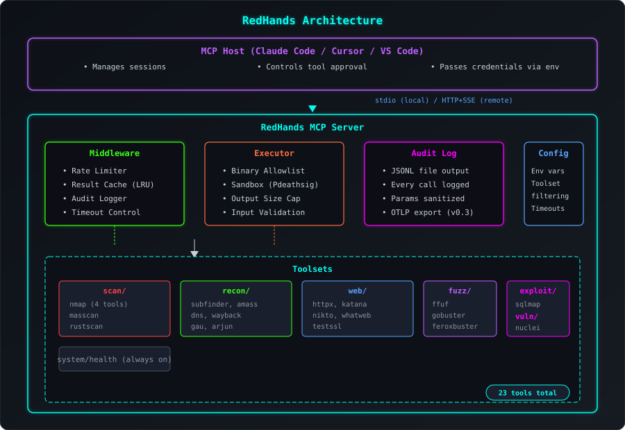
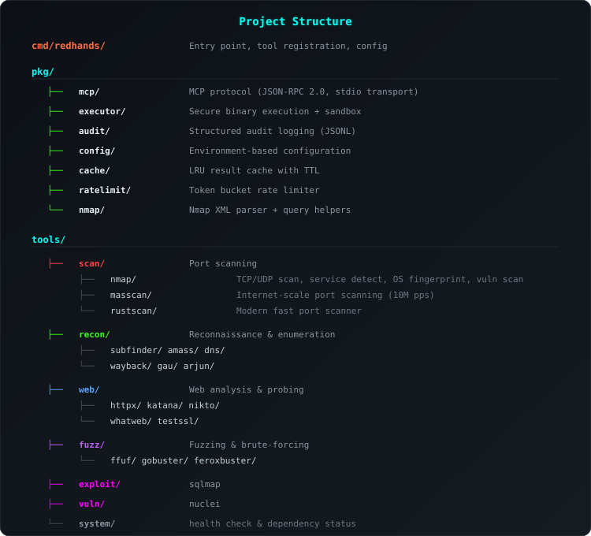
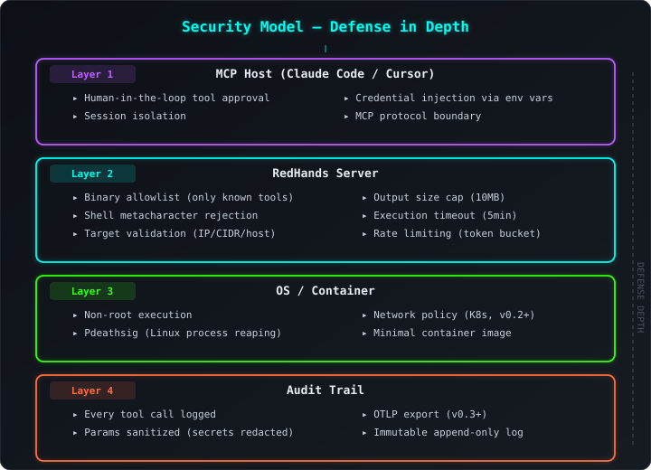

# RedHands — Product Requirements Document

## Overview

RedHands is an MCP (Model Context Protocol) server that exposes offensive security tools to AI agents. It follows the same architecture patterns used by GitHub's MCP server and Atlassian's MCP server — a single-binary Go server with zero external dependencies, multi-transport support (stdio/SSE/WebSocket), tool chaining, structured output parsing, report generation, and a JSON plugin system.

**Current state:** v0.5.0 — 277 registered tools across 32 toolsets, multi-transport (stdio/SSE/WebSocket), authentication (API key/mTLS), sequential workflow engine plus the multi-stage campaign engine (conditions, parallelism, goto recovery, checkpoint/resume, playbooks, engagement binding, target-database recording, MITRE ATT&CK tagging), managed daemon lifecycle for defense engines and C2/scanner servers, structured parsers, report generation, plugin system, Docker image with a verified tool subset.

---

## Design Principles

1. **One server, many tools** — A single `redhands` binary covers all offensive security tooling (like GitHub covers all of GitHub's API surface in one server)
2. **Toolsets for filtering** — Tools grouped by domain; users enable only what they need via `--toolsets` or env vars
3. **Zero external dependencies** — Pure Go stdlib implementation for maximum portability and minimal attack surface
4. **Auth lives outside** — MCP hosts (Claude Code, Cursor, VS Code) manage credentials; RedHands accepts config via env vars, not custom RBAC
5. **Multi-transport** — Stdio for local dev, SSE/WebSocket for remote/team deployment
6. **Observability built-in** — Every tool call is audit-logged; structured output parsing for downstream consumption
7. **Safe by default** — Allowlisted binaries, input validation, output caps, rate limiting, authentication
8. **Extensible without code** — JSON plugin definitions for custom tool wrappers

---

## Target Users

| User | Use Case |
|------|----------|
| Pentest teams | AI-assisted recon, scanning, vuln assessment, AD attacks via Claude/Cursor |
| Security engineers | Automated security workflows triggered by AI agents |
| Red team operators | AI-augmented offensive operations with full audit trail |
| DevSecOps | Integrate security scanning into AI-powered CI/CD pipelines |
| Purple teams | Network analysis and incident investigation with tshark/packet tools |

---

## Architecture

  

### Directory Layout

  

---

## Toolsets & Tools (277 registered across 32 toolsets)

### Toolset: `nmap` — Nmap Suite (4 tools)

| Tool | Binary | Description |
|------|--------|-------------|
| `nmap_port_scan` | nmap | TCP/UDP port scanning (SYN, connect, UDP) |
| `nmap_service_detect` | nmap | Service and version detection (-sV) |
| `nmap_os_detect` | nmap | OS fingerprinting (-O) |
| `nmap_vuln_scan` | nmap | NSE vulnerability scripts |

### Toolset: `scan` — Port Scanning (2 tools)

| Tool | Binary | Description |
|------|--------|-------------|
| `masscan_scan` | masscan | Internet-scale port scanning (10M pps) |
| `rustscan_scan` | rustscan | Modern fast port scanner (all 65535 ports) |

### Toolset: `recon` — Reconnaissance & Enumeration (6 tools)

| Tool | Binary | Description |
|------|--------|-------------|
| `subfinder_enum` | subfinder | Passive subdomain enumeration |
| `amass_enum` | amass | Network mapping and ASN discovery |
| `dns_lookup` | dig | DNS record queries (A, AAAA, MX, NS, TXT, etc.) |
| `waybackurls` | waybackurls | Fetch archived URLs from the Wayback Machine |
| `gau_urls` | gau | Fetch URLs from AlienVault OTX, Wayback, CommonCrawl, URLScan |
| `arjun_discover` | arjun | HTTP parameter discovery (hidden GET/POST params) |

### Toolset: `web` — Web Analysis & Probing (5 tools)

| Tool | Binary | Description |
|------|--------|-------------|
| `httpx_probe` | httpx | HTTP service probing with tech detection |
| `katana_crawl` | katana | Next-gen web crawler (JS crawling, headless) |
| `nikto_scan` | nikto | Web server vulnerability scanner |
| `whatweb_fingerprint` | whatweb | Web technology fingerprinting |
| `testssl_scan` | testssl.sh | TLS/SSL encryption testing |

### Toolset: `fuzz` — Fuzzing & Brute-forcing (3 tools)

| Tool | Binary | Description |
|------|--------|-------------|
| `ffuf_fuzz` | ffuf | Web fuzzing (dirs, params, vhosts) |
| `gobuster_dir` | gobuster | Directory/file brute-forcing |
| `feroxbuster_scan` | feroxbuster | Recursive content discovery (forced browsing) |

### Toolset: `exploit` — Exploitation (1 tool)

| Tool | Binary | Description |
|------|--------|-------------|
| `sqlmap_scan` | sqlmap | Automatic SQL injection detection and exploitation |

### Toolset: `vuln` — Vulnerability Scanning (1 tool)

| Tool | Binary | Description |
|------|--------|-------------|
| `nuclei_scan` | nuclei | Template-based vulnerability scanning |

### Toolset: `impacket` — Active Directory / SMB (8 tools)

| Tool | Binary | Description |
|------|--------|-------------|
| `impacket_secretsdump` | impacket-secretsdump | Dump SAM/LSA/NTDS.dit secrets |
| `impacket_psexec` | impacket-psexec | PsExec-style remote execution |
| `impacket_wmiexec` | impacket-wmiexec | WMI-based remote execution |
| `impacket_smbclient` | impacket-smbclient | SMB client operations |
| `impacket_dcomexec` | impacket-dcomexec | DCOM remote execution |
| `impacket_get_tgt` | impacket-getTGT | Request Kerberos TGT |
| `impacket_get_st` | impacket-getST | Request service ticket (Kerberoast/delegation) |
| `impacket_ntlmrelay` | impacket-ntlmrelayx | NTLM relay attack |

### Toolset: `sliver` — Sliver C2 Framework (9 tools)

| Tool | Binary | Description |
|------|--------|-------------|
| `sliver_generate` | sliver-client | Generate implant (mTLS, HTTP/S, DNS, WireGuard) |
| `sliver_listeners` | sliver-client | Manage C2 listeners |
| `sliver_sessions` | sliver-client | List/interact with sessions |
| `sliver_beacons` | sliver-client | List/interact with beacons |
| `sliver_execute` | sliver-client | Execute commands on implant |
| `sliver_upload` | sliver-client | Upload files to implant |
| `sliver_download` | sliver-client | Download files from implant |
| `sliver_pivot` | sliver-client | Pivot setup and management |
| `sliver_portfwd` | sliver-client | Port forwarding through implant |

### Toolset: `tunnel` — Network Tunneling (5 tools)

| Tool | Binary | Description |
|------|--------|-------------|
| `chisel_server` | chisel | Start reverse tunnel endpoint |
| `chisel_client` | chisel | Connect client (forward/reverse/SOCKS) |
| `ligolo_start` | ligolo-proxy | Start Ligolo-ng proxy server |
| `ligolo_route` | ligolo-proxy | Add routes through tunnel |
| `ligolo_listener` | ligolo-proxy | Manage listeners on agent |

### Toolset: `crack` — Password Cracking (6 tools)

| Tool | Binary | Description |
|------|--------|-------------|
| `hashcat_crack` | hashcat | Crack hashes (dictionary, rules, masks) |
| `hashcat_benchmark` | hashcat | Benchmark hash types |
| `hashcat_show` | hashcat | Show cracked from potfile |
| `john_crack` | john | Crack passwords with John the Ripper |
| `john_show` | john | Show cracked passwords |
| `john_formats` | john | List supported hash formats |

### Toolset: `crackmapexec` — Network Protocol Attacks (5 tools)

| Tool | Binary | Description |
|------|--------|-------------|
| `cme_smb` | crackmapexec | SMB enumeration/exec/pass-the-hash |
| `cme_winrm` | crackmapexec | WinRM execution |
| `cme_ldap` | crackmapexec | LDAP enumeration |
| `cme_mssql` | crackmapexec | MSSQL queries/execution |
| `cme_ssh` | crackmapexec | SSH credential spray/exec |

### Toolset: `certipy` — AD Certificate Services (6 tools)

| Tool | Binary | Description |
|------|--------|-------------|
| `certipy_find` | certipy | Find AD CS templates and CAs |
| `certipy_req` | certipy | Request certificates |
| `certipy_auth` | certipy | Authenticate via PKINIT |
| `certipy_shadow` | certipy | Shadow credentials attack |
| `certipy_forge` | certipy | Golden certificate forgery |
| `certipy_relay` | certipy | NTLM relay to AD CS |

### Toolset: `tshark` — Packet Analysis (5 tools)

| Tool | Binary | Description |
|------|--------|-------------|
| `tshark_capture` | tshark | Capture packets (interface, filter, duration) |
| `tshark_read` | tshark | Read pcap with display filter |
| `tshark_stats` | tshark | Protocol statistics |
| `tshark_extract` | tshark | Extract fields from captures |
| `tshark_follow` | tshark | Follow TCP/UDP/HTTP streams |

### Toolset: `kubedagger` — Kubernetes Offensive (69 tools)

| Tool | Binary | Description |
|------|--------|-------------|
| 66 eBPF-powered CLI wrappers | kubedagger-client | Container escape, syscall hooking, network sniffing, process hiding, crypto mining, rootkit deployment, C2/disruption/evasion, operator tooling, and more |
| `kubedagger_server_start/stop/status` | kubedagger-server | Managed C2 server daemon lifecycle (events feed `kubedagger_report`) |

### Toolset: `barzakh` — UEFI Bootkit Adversary Simulation (13 tools)

| Tool | Binary | Description |
|------|--------|-------------|
| `barzakh_list`, `barzakh_generate`, `barzakh_corpus`, `barzakh_scan`, `barzakh_validate`, `barzakh_scenario`, `barzakh_robustness`, `barzakh_detectors`, `barzakh_baseline`, `barzakh_intel` | barzakh-adversary | UEFI bootkit payload generation/corpus management and scanning with 138 detectors, scenario validation, robustness/detector/baseline/intel tooling |
| `barzakh_server_start/stop/status` | barzakh-server | Managed REST scanner-server daemon lifecycle |

### Toolset: `telecom` — StaticZero Telecom Defense (24 tools)

| Tool | Binary | Description |
|------|--------|-------------|
| `telecom_doctor`, `telecom_firmware_analyze`, `telecom_firmware_extract`, `telecom_firmware_diff`, `telecom_firmware_nv_dump`, `telecom_sdr_scan` | staticzero-defense / modem-firmware / sdr-bridge | Defense preflight, baseband firmware static analysis, receive-only LTE scanning |
| `telecom_threats`, `telecom_alerts`, `telecom_stats`, `telecom_defense_start/stop/status` | staticzero-defense | Defense-engine HTTP queries and managed defense-engine lifecycle |

### Toolset: `aegis` — Aegis-Shadow Analysis (13 tools)

| Tool | Binary | Description |
|------|--------|-------------|
| `aegis_alerts_parse`, `aegis_alerts_tail`, `aegis_modules_list`, `aegis_defense_config_read`, `aegis_defense_config_write`, `aegis_offense_plan` | aegis-shadow | Read-only rootkit alert parsing/tailing, module catalog, defense config, offense planning (renders the manual command line instead of executing it) |
| `aegis_defense_start/stop/status` | aegis-shadow-defense | Managed defense-engine lifecycle |

### Toolset: `bloodhound` — AD Graph Analysis (4 tools)

| Tool | Binary | Description |
|------|--------|-------------|
| `bloodhound_collect`, `bloodhound_find_path`, `bloodhound_mark_owned`, `bloodhound_analyze` | bloodhound-python | Active Directory data collection and attack-path analysis |

### Toolset: `responder` — LLMNR/NBT-NS Poisoning (4 tools)

| Tool | Binary | Description |
|------|--------|-------------|
| `responder_start`, `responder_analyze`, `responder_logs`, `responder_status` | responder | Credential poisoning with capture analysis and log review |

### Toolset: `evilwinrm` — WinRM Shell (5 tools)

| Tool | Binary | Description |
|------|--------|-------------|
| `evilwinrm_shell`, `evilwinrm_upload`, `evilwinrm_download`, `evilwinrm_dll_inject`, `evilwinrm_ps_exec` | evil-winrm | WinRM remote shell with file transfer, DLL injection, and PsExec |

### Toolset: `coercion` — AD Forced Authentication (4 tools)

| Tool | Binary | Description |
|------|--------|-------------|
| `coercion_petitpotam`, `coercion_printerbug`, `coercion_dfscoerce`, `coercion_check` | python3 (PetitPotam / dementor / DFSCoerce) | Forced-authentication coercion attacks and target susceptibility checks |

### Toolset: `phishing` — GoPhish Campaigns (5 tools, env-gated)

| Tool | Binary | Description |
|------|--------|-------------|
| `phishing_campaign_create`, `phishing_campaign_status`, `phishing_template_create`, `phishing_landing_create`, `phishing_groups_create` | GoPhish API | Phishing campaign/template/landing/group management; registered only when `REDHANDS_GOPHISH_URL` and `REDHANDS_GOPHISH_API_KEY` are set |

### Toolset: `wireless` — Wi-Fi Attacks (6 tools)

| Tool | Binary | Description |
|------|--------|-------------|
| `wireless_monitor`, `wireless_scan`, `wireless_deauth`, `wireless_capture`, `wireless_crack`, `wireless_bettercap` | aircrack-ng / bettercap | Monitor mode, AP scanning, deauth, capture, handshake cracking, MITM |

### Toolset: `mobile` — Mobile Testing (6 tools)

| Tool | Binary | Description |
|------|--------|-------------|
| `mobile_frida_attach`, `mobile_frida_spawn`, `mobile_objection`, `mobile_apk_decompile`, `mobile_apk_repackage`, `mobile_adb_shell` | frida / objection / apktool / adb | Dynamic instrumentation, APK analysis/repackaging, device shell |

### Toolset: `cloud` — Cloud Security (8 tools)

| Tool | Binary | Description |
|------|--------|-------------|
| `cloud_scout_aws`, `cloud_scout_azure`, `cloud_prowler`, `cloud_pacu_enum`, `cloud_roadtools_auth`, `cloud_roadtools_dump`, `cloud_enum_s3`, `cloud_enum_blobs` | scout / prowler / pacu / roadtx / aws | AWS/Azure security review, exploitation, auth abuse, storage enumeration |

### Toolset: `targetdb` — Target Database (6 tools)

| Tool | Binary | Description |
|------|--------|-------------|
| `targetdb_add_host`, `targetdb_list_hosts`, `targetdb_add_finding`, `targetdb_query_findings`, `targetdb_add_cred`, `targetdb_list_creds` | — | Persistent recording and querying of hosts, findings, and credential metadata |

### Toolset: `intelligence` — Intelligence Layer (6 tools)

| Tool | Binary | Description |
|------|--------|-------------|
| `correlation_analyze`, `attackgraph_build`, `attackgraph_path`, `attackgraph_export`, `mitre_lookup`, `risk_score_calculate` | — | Finding correlation, attack-graph build/path/export, MITRE ATT&CK lookup, risk scoring |

### Toolset: `operations` — Engagement Operations (8 tools; 2 env-gated)

| Tool | Binary | Description |
|------|--------|-------------|
| `engagement_create`, `engagement_switch`, `engagement_list`, `loot_add`, `loot_list`, `loot_search` | — | Engagement scoping and loot management |
| `credstore_add`, `credstore_search` | — | Encrypted credential store; registered only when `REDHANDS_CREDSTORE_KEY` is set |

### Toolset: `reporting` — Reporting & Evidence (5 tools)

| Tool | Binary | Description |
|------|--------|-------------|
| `report_sarif`, `report_executive`, `report_compliance` | — | SARIF export, executive summaries, compliance mapping |
| `evidence_list`, `evidence_screenshot` | — | Evidence artifact index and validated PNG screenshot capture |

### System (always enabled, 1 tool)

| Tool | Binary | Description |
|------|--------|-------------|
| `redhands_health` | — | Server health check and binary dependency status |

### Default Toolsets

When `REDHANDS_TOOLSETS` is unset: all toolsets are enabled. 270 tools are registered on default startup; the 5 GoPhish tools additionally require `REDHANDS_GOPHISH_URL`/`REDHANDS_GOPHISH_API_KEY` and the 2 credstore tools additionally require `REDHANDS_CREDSTORE_KEY`, for 277 registered tools in total.

---

## Infrastructure

### Transports

| Transport | Protocol | Use Case |
|-----------|----------|----------|
| stdio (default) | Line-delimited JSON-RPC | Local dev with Claude Code/Cursor/VS Code |
| SSE | HTTP + Server-Sent Events | Remote/team deployment, multiple clients |
| WebSocket | Raw frames (stdlib, no deps) | Real-time bidirectional communication |

### Authentication

| Mode | Mechanism | Use Case |
|------|-----------|----------|
| none (default) | — | Local stdio usage |
| apikey | `X-API-Key` header | Simple shared-secret for SSE/WS |
| mtls | Client certificate verification | Zero-trust deployments |

### Tool Chaining / Workflow Engine

Sequential tool execution with variable substitution:
- `$prev.text` — previous step's text output
- `$step[N].text` — Nth step's text output
- Early abort on error
- Combined results from all steps

### Structured Output Parsing

Built-in parsers registered via `pkg/parser/`:
- **NmapXML** — hosts, ports, services, scripts
- **NucleiJSON** — findings grouped by severity
- **MasscanJSON** — host/port pairs

### Report Generation

- **Markdown** — structured `.md` reports
- **HTML** — self-contained with inline CSS, no external resources

### Plugin System

JSON tool definitions loaded from `REDHANDS_PLUGINS_DIR`:
- `text/template` arg substitution
- Implements `mcp.Tool` interface
- Input validation inherited from executor sandbox
- Hot-reload on server startup

### Installation Infrastructure

Non-Docker installation system for native usage:

| Script | Purpose | Platform |
|--------|---------|----------|
| `scripts/install.sh` | One-line quick installer (binary + optional tools) | Linux, macOS |
| `scripts/install-tools.sh` | Full tool dependency installer with profiles | Linux, macOS |
| `scripts/install-tools.ps1` | Full tool dependency installer with profiles | Windows |
| `scripts/check-deps.sh` | Dependency checker with install hints | Linux, macOS |

**Profiles** map to common engagement types (matching `scripts/install-tools.sh`):
- `minimal` — nmap, subfinder, httpx, nuclei
- `web` — nmap plus the recon, web, and fuzz sets, masscan, rustscan, nuclei, sqlmap
- `network` — nmap, masscan, rustscan, tshark, chisel, ligolo-proxy
- `ad` — nmap, impacket, crackmapexec, certipy, hashcat, john
- `k8s` — nmap, kubedagger-client, kubedagger-operator, kubedagger-server
- `uefi` — barzakh-adversary, barzakh-scanner, barzakh-server
- `telecom` — staticzero-defense, staticzero-offense, modem-firmware, sdr-bridge (Linux only)
- `aegis` — aegis-shadow-defense (Linux only)
- `recon` — recon plus web sets (subfinder, amass, dig, waybackurls, gau, arjun, httpx, katana, nikto, whatweb, testssl.sh)
- `all` — everything

**OS detection**: install-tools.sh detects Debian/Fedora/Arch/macOS and uses the correct package manager (apt/dnf/pacman/brew).

**Install categories per tool**:
1. System packages (apt/dnf/pacman/brew)
2. Python tools (pip install)
3. Go tools (go install)
4. Binary releases (curl from GitHub releases)

---

## Configuration Reference

All configuration via environment variables (`REDHANDS_*` prefix):

| Variable | Default | Description |
|----------|---------|-------------|
| `REDHANDS_TOOLSETS` | (all) | Comma-separated toolsets to enable |
| `REDHANDS_TIMEOUT` | `5m` | Execution timeout per tool call |
| `REDHANDS_MAX_OUTPUT` | `10485760` | Max output bytes per execution (10MB) |
| `REDHANDS_RATE_LIMIT` | `10` | Token bucket refill rate (requests/sec) |
| `REDHANDS_RATE_BURST` | `20` | Token bucket burst capacity |
| `REDHANDS_CACHE_TTL` | `5m` | Result cache TTL |
| `REDHANDS_CACHE_SIZE` | `100` | Max cached results (LRU eviction) |
| `REDHANDS_AUDIT_FILE` | `audit.jsonl` | Audit log file path |
| `REDHANDS_TRANSPORT` | `stdio` | Transport: `stdio`, `sse`, or `ws` |
| `REDHANDS_SSE_ADDR` | `:8080` | SSE HTTP listen address |
| `REDHANDS_WS_ADDR` | `:8081` | WebSocket listen address |
| `REDHANDS_AUTH` | `none` | Auth mode: `none`, `apikey`, or `mtls` |
| `REDHANDS_API_KEY` | — | API key (required when auth=apikey) |
| `REDHANDS_TLS_CERT` | — | TLS certificate path |
| `REDHANDS_TLS_KEY` | — | TLS private key path |
| `REDHANDS_TLS_CA` | — | CA cert for mTLS client verification |
| `REDHANDS_PLUGINS_DIR` | `./plugins` | Directory for JSON plugin definitions |

---

## Release History

### v0.5.0 — Campaign Framework & Managed Servers (current)

- **Multi-stage campaign engine wired at startup**: `campaign/run`, `status`, `list`, `resume`, `cancel`, `templates`, `template/get`, `template/save` — conditional steps (text and JSON-path operators), parallel fan-out with failure aggregation, `goto:` failure recovery with a bounded jump budget, per-step checkpoint/resume and cancellation; `REDHANDS_WORKFLOW_STATE_DIR`, `REDHANDS_WORKFLOW_TEMPLATES_DIR`, `REDHANDS_WORKFLOW_MAX_PARALLEL` now functional
- **Structured dataflow**: `$prev.json.path`, `$step[N].json.path`, `${id.json.path}` extraction from raw or markdown-fenced JSON with native type preservation
- **Playbooks**: point-and-shoot campaign templates shipped in `./playbooks` with validation tests
- **Engagement binding**: campaigns bind to the active engagement (failing fast on a mismatch) and bindings are re-validated on resume
- **Target-database recording and MITRE ATT&CK tagging**: record rules map step output to targetdb hosts/services/credentials/findings; steps accept `mitre:` technique tags aggregated into campaign results
- **CLI campaign commands**: `redhands-cli campaign run`, `run playbook`, `status`, `list`, `resume`, `cancel`, `templates`
- **KubeDagger CLI-accurate wrappers + 12 new tools**: every wrapper corrected against the real `kubedagger-client` cobra CLI; new `fs_watch`, `pipe_prog`, `postgres`, `proctree`, `mitre_export`, `detection`, `report`, `vap_backdoor`, `operator_status` tools (69 tools total; 358 test cases)
- **Barzakh expansion**: corrected scan/flags drift; new `barzakh_validate`, `barzakh_scenario`, `barzakh_robustness`, `barzakh_detectors`, `barzakh_baseline`, `barzakh_intel` tools (13 tools total, 138 detectors)
- **New toolsets**: `telecom` (StaticZero — doctor, firmware analysis, SDR scan, defense API; 12 tools) and `aegis` (Aegis-Shadow analysis; 9 tools)
- **Managed daemon lifecycle with secret redaction**: `kubedagger_server_{start,stop,status}` and `barzakh_server_{start,stop,status}` via the background process manager, which redacts secret-bearing flag values in all recorded argv
- **Docker image**: `kubedagger-server` and `barzakh-server` installed via the checksum-verified dependency lock
- **277 registered tools** across 32 toolsets

### v0.4.0 — Offensive Security Platform Expansion

- **8 new toolsets**: BloodHound (4), Responder (4), Evil-WinRM (5), Coercion (4), Phishing (5, GoPhish API), Wireless (6), Mobile (6), Cloud (8)
- **Intelligence layer**: target database, attack-graph build/path/export, MITRE ATT&CK lookup, risk scoring, finding correlation
- **Engagement operations**: engagement create/switch/list, loot add/list/search, encrypted credential store
- **Reporting**: SARIF export, executive summary, compliance mapping, evidence capture with screenshot validation
- **Infrastructure**: hot-reload plugins, TCP transport, dry-run mode, `redhands-cli` companion CLI, web dashboard
- **Workflow/OPSEC prototypes**: parallel/conditional/resumable workflow orchestration, OPSEC middleware (traffic shaping, jitter, source rotation, IOC tracking), webhooks, and multi-operator sync added as library prototypes — not wired into startup (the campaign engine shipped in v0.5.0; the remaining prototype settings are rejected as unsupported configuration)
- **Code quality**: golangci-lint/errcheck/staticcheck fixes and error-handling refactors across the codebase

### v0.3.0 — KubeDagger Install Infrastructure & Barzakh Toolset

- **KubeDagger installation infrastructure**: `kubedagger-client` and `kubedagger-operator` (v0.1.0 release) integrated into the Dockerfile, install scripts, and dependency checker; new `k8s` install profile
- **Barzakh UEFI toolset**: replaced the JSON plugins with a typed Go toolset (`barzakh_list`, `barzakh_generate`, `barzakh_corpus`, `barzakh_scan`) backed by the `barzakh-adversary`/`barzakh-scanner` binaries

### v0.2.1 — Non-Docker Installation

- **One-line installer**: `curl -fsSL .../install.sh | bash` for binary download or build from source
- **Profile-based tool installation**: `minimal`, `web`, `network`, `ad`, `recon`, `all` profiles matching REDHANDS_TOOLSETS concepts
- **Cross-platform scripts**: `install-tools.sh` (Linux/macOS with apt/dnf/pacman/brew detection) and `install-tools.ps1` (Windows with Chocolatey/Scoop)
- **Dependency checker**: `check-deps.sh` reports installed/missing tools with per-tool install hints
- **Makefile targets**: `make install`, `make install-tools PROFILE=web`, `make check-deps`
- **Windows support**: Full PowerShell installer with `-Profile`, `-Check` parameters

### v0.2.0 — Full Arsenal

- **7 new toolsets**: Impacket (8 tools), Sliver C2 (9), Chisel/Ligolo tunneling (5), Hashcat/John cracking (6), CrackMapExec (5), Certipy AD CS (6), tshark packet analysis (5)
- **Multi-transport**: SSE (stdlib net/http) and WebSocket (raw frame protocol, stdlib crypto/sha1)
- **Authentication**: API key (`X-API-Key` header) and mTLS (client cert verification)
- **Workflow engine**: Sequential tool chaining with `$prev.text` / `$step[N].text` variable substitution
- **Structured parsers**: Nmap XML, Nuclei JSON, Masscan JSON
- **Report generation**: Markdown and self-contained HTML formats
- **Plugin system**: JSON tool definitions with `text/template` arg substitution
- **Docker image**: Multi-stage build with all security tools pre-installed
- **Unit tests**: Full coverage across all new toolsets and infrastructure packages
- **125 tools** across 15 toolsets + system health

### v0.1.0 — First Release

- MCP protocol core (JSON-RPC 2.0, stdio transport)
- 23 tools across 7 toolsets (nmap, scan, recon, web, fuzz, exploit, vuln) + system
- Category-based directory layout (tools organized by domain)
- Secure binary execution with allowlist + sandbox
- Structured audit logging (JSONL)
- Input validation and shell metacharacter rejection
- Toolset filtering via `REDHANDS_TOOLSETS` env var
- Token bucket rate limiting middleware
- LRU result cache with TTL
- Binary auto-discovery

---

## Release Plan

### Remaining — Observability & Deployment

**Goal:** Production-ready deployment with full observability.

| Deliverable | Details |
|-------------|---------|
| OpenTelemetry | OTLP export for traces and metrics |
| Structured logging | slog with JSON output, configurable level |
| Metrics | Tool call count, duration histogram, error rate |
| Helm chart | Kubernetes deployment with configurable resources |

The health endpoint planned for this milestone is done: `GET /health` is available on the SSE and WS transports.

### Advanced Features (v0.4.0 scope — current status)

**Goal:** Intelligent workflow support and expanded coverage.

| Deliverable | Details | Status |
|-------------|---------|--------|
| Workflow hints | Tool descriptions that guide AI agents to chain tools logically | Planned |
| Finding dedup | Cross-tool finding deduplication | Planned |
| Conditional workflows | Branching based on step results | Shipped in v0.5.0 (campaign engine: conditions, parallel fan-out, goto recovery) |
| BloodHound toolset | AD attack-path analysis | Shipped in v0.4.0 (4 tools) |
| Responder toolset | LLMNR/NBT-NS poisoning | Shipped in v0.4.0 (4 tools) |
| Evil-WinRM toolset | WinRM shell | Shipped in v0.4.0 (5 tools) |
| Rubeus | Kerberos interaction toolkit | Not implemented |

---

## Non-Goals (Explicit)

| Not building | Reason |
|--------------|--------|
| Custom RBAC/permissions | MCP hosts control tool approval; adding our own layer adds friction without value |
| Multi-tenancy in the server | Deploy separate instances per team; simpler, more isolated |
| Web UI / dashboard | The AI agent IS the UI; audit logs feed into existing SIEM/Grafana |
| External dependencies | Stdlib-only policy keeps the binary portable and the supply chain minimal |
| Database persistence | Audit logs go to files/OTLP; findings returned to the agent directly |
| PDF reports | Would require external dep (wkhtmltopdf); users convert HTML→PDF externally |

---

## Security Model

  

### Defense in Depth

1. **Transport layer** — mTLS for zero-trust, API key for simple shared-secret
2. **Input validation** — Shell metacharacter rejection on all string parameters
3. **Binary allowlist** — Only explicitly configured security tools can be executed
4. **Sandbox** — Execution timeout, output size cap, controlled argument construction
5. **Rate limiting** — Token bucket prevents abuse and runaway tool calls
6. **Audit logging** — Every invocation logged with full parameters and results

---

## Success Metrics

| Metric | Target |
|--------|--------|
| Tool call latency (overhead) | <50ms added beyond tool execution time |
| Concurrent scans supported | 10+ simultaneous without degradation |
| Binary startup time | <100ms to first `tools/list` response |
| Test coverage | >80% on pkg/ packages |
| Supported tools | 277 registered (v0.6.x), expanding |
| Container image size | <500MB with all tools installed |
| Zero external Go dependencies | Maintained across all releases |

---

## Competitive Landscape

| Project | Scope | Difference from RedHands |
|---------|-------|--------------------------|
| GitHub MCP Server | GitHub API | Different domain; same architecture pattern |
| mcp-atlassian | Jira/Confluence | Different domain; Python, similar patterns |
| PentestGPT | AI pentesting | Monolithic, no MCP, not composable |
| HackerGPT | AI security chat | Chat-only, no tool protocol |
| RedHands | Security tool MCP | Standardized MCP protocol, composable with any AI agent, 277 registered tools |

RedHands is the first production-grade MCP server purpose-built for offensive security tooling.
